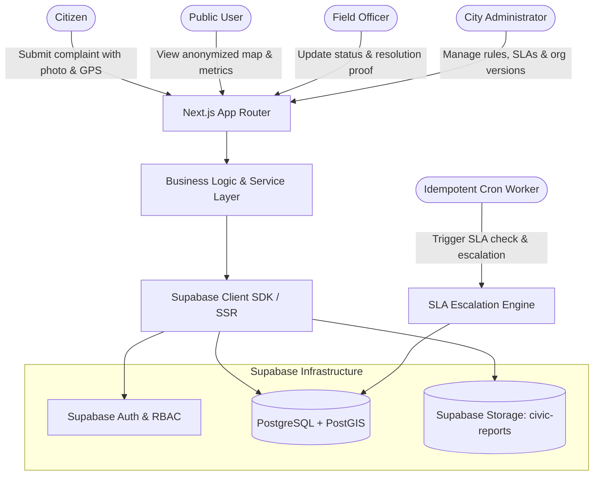

# CIVOARA — System Architecture Documentation

## 1. System Overview

CIVOARA is a municipal civic accountability platform. The system operates as a unified Next.js App Router application backed by PostgreSQL with PostGIS extensions via Supabase. It coordinates citizens, field officers, supervisors, commissioners, and city administrators through deterministic routing, immutable event streams, and real-time geospatial intelligence.



---

## 2. Directory Structure & Modular Organization

```
src/
├── app/
│   ├── (auth)/                  # Auth workflows: login, register, reset
│   ├── (public)/                # Landing page, public issue map, transparency analytics
│   ├── citizen/                 # Citizen dashboard and issue tracking
│   ├── officer/                 # Field officer worklist and task management
│   ├── admin/                   # Administrative routing, SLA, and org restructuring
│   ├── report/                  # Citizen civic issue reporting wizard
│   ├── api/                     # Internal API endpoints and cron webhooks
│   └── layout.tsx               # Root application layout with theme & font providers
│
├── components/
│   ├── ui/                      # Primitive atomic components (Button, Input, Select, Modal, Badge, Toast)
│   ├── layout/                  # Shared headers, navigation sidebars, breadcrumbs, footers
│   ├── citizen/                 # Issue reporting form, photo uploader, citizen dashboard cards
│   ├── officer/                 # Officer task list, status update modal, resolution proof upload
│   ├── admin/                   # Routing rule manager, SLA configurator, org restructuring wizard
│   ├── dashboard/               # Performance charts, SLA gauges, department rankings
│   └── maps/                    # Leaflet interactive map, GPS location picker, cluster pins
│
├── lib/
│   ├── supabase/                # Browser client, server client (SSR cookies), and service role client
│   ├── auth/                    # Server-side role guard, session validation, access control
│   ├── validation/              # Zod schemas for form submissions, API requests, routing rules
│   ├── routing/                 # Automatic category + ward routing resolution engine
│   ├── sla/                     # SLA deadline computation, level 0-3 escalation handler
│   ├── clustering/              # PostGIS ST_DWithin duplicate detection and canonical issue linkage
│   ├── notifications/           # In-app and system notification dispatcher
│   └── services/                # Encapsulated data access and business transactions
│
├── hooks/                       # Reusable React hooks (useAuth, useLocation, useToast, useDebounce)
└── types/                       # TypeScript interfaces for database entities, API contracts, domain types

supabase/
├── migrations/                  # 15 discrete schema migrations with RLS policies and spatial indices
└── seed/                        # Controlled test accounts, sample wards, departments, and routing rules

docs/
└── ARCHITECTURE.md              # System design and specifications
```

---

## 3. Core Subsystems

### 3.1. Identity & Role-Based Access Control (RBAC)
- **Roles**: `citizen`, `officer`, `supervisor`, `commissioner`, `admin`.
- Role verification is enforced in PostgreSQL Row Level Security (RLS) policies using claims stored in `profiles.role` joined with `auth.users`.
- Server Components and API route handlers verify role claims server-side using Supabase server clients with cookie session validation. Browser-supplied role claims are never trusted.

### 3.2. Geospatial Routing & Ward Resolution
- Municipal ward boundaries are modeled as PostGIS polygon geometries (`GEOGRAPHY(POLYGON, 4326)`).
- Submitted complaint coordinates (`latitude`, `longitude`) are resolved to a responsible ward via `ST_Intersects` or `ST_Contains`.
- If a point falls outside all registered municipal wards, the report is placed into an administrative review queue without failing silently.
- Configurable routing rules resolve the responsible department and officer based on issue category and ward.

### 3.3. Deterministic SLA & Escalation Engine
- Every category is assigned an SLA resolution duration (e.g., Pothole: 48h, Garbage: 24h, Streetlight: 72h, Water leakage: 12h, Other: 96h).
- Timers start at the moment of assignment, persisting the active policy version and target deadline.
- An idempotent server-side escalation processor executes via a secure cron webhook protected by a `CRON_SECRET`.
- Multi-tier escalation:
  - Level 0: Assigned Officer
  - Level 1: Supervisor
  - Level 2: Commissioner
  - Level 3: Municipal Administrator
- Escalation steps are recorded in `escalation_steps` with unique constraints preventing duplicate escalation events.

### 3.4. Duplicate Issue Clustering
- Multiple citizen complaints regarding the same incident are grouped into a canonical issue cluster using spatial proximity (`ST_DWithin`) and category matching within a configurable time window.
- Individual citizen reports are preserved in `issue_reports`, providing citizens with personal tracking while consolidating work orders for municipal field teams.

### 3.5. Organizational Restructuring & Fair SLA Segments
- Municipal reorganizations (ward reassignments, department mergers) are versioned via `organization_versions` and `ownership_segments`.
- When responsibilities shift, previous ownership segments are closed with their elapsed duration preserved.
- New ownership segments are opened under current policies without erasing historical SLA performance or artificially resetting overall complaint age.

### 3.6. Public Transparency & Anonymization
- Public views query sanitized views that strictly omit citizen personal identifiable information (PII) such as phone numbers, email addresses, and private residences.
- Department performance rankings are calculated using weighted SLA compliance, volume, and mean time to resolution, with sample size disclosures.
